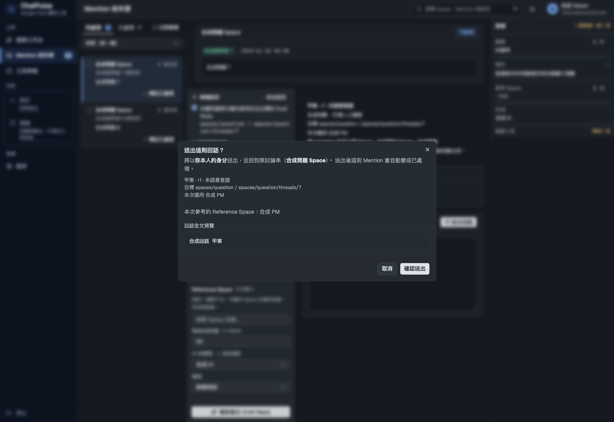

# 使用專案脈絡產生 Draft Reply

專案來源只屬於建立它的 Viewer，與既有 Git 登錄是不同的資料。來源保存後不會自動讀取，也不會依 PM 的姓名或上一題猜專案。

1. 在啟動儀表板前設定 `CHATPULSE_PROJECT_CONTEXT_ENABLED=true`。預設關閉。
2. 開啟 Mention 的草稿設定，勾選「啟用我的專案脈絡」。
3. 展開「管理專案來源」，輸入名稱，從清單加入 Space、PM 與既有 Git 環境。PM 請將來源類別改為 PM。Git 可指定 repo 內相對路徑，用逗號分隔。
4. 保存專案。每份最多 12 筆來源，可更新名稱與整份來源，刪除或換環境可先移除該來源再加入。
5. 本題明選專案。每筆來源預設僅 metadata，勾選後才會讀取內容並放入本題的回話脈絡。每題最多 2 筆 Git。
6. 確認畫面顯示的確切 Space/thread，再產生 Draft Reply。同一 PM 討論多案時，每題都要明選。
7. 檢查「本次專案範圍」與已回報實讀資訊，閱讀並修改草稿，再經過二次確認送出。

畫面與送出確認會保留生成當下的專案名稱、revision、來源用途與目標。未勾選來源的關聯與內容不進 prompt。本題專案名稱會作範圍提示，這不代表系統能自動分離同一 Space 的不同專案對話。所有草稿都標示「未語意查證」，人工編輯也不會改成已查證。

切換 Mention 會清除本題專案與同意。同題換專案、來源、同意或讀取選項會清除產出並撤銷前端操作。停止串流不代表已送出的供應商 HTTP 呼叫已停止。沒有 done 的內容只算部分草稿，不可透過專案模式送出。

重新載入會顯示歷史 snapshot，不回填來源核准或同意。修改專案或 Git 讀取設定後，舊草稿可能已失效，請重新選擇、同意並產生。關閉功能後仍可閱讀歷史專案草稿，但不能以失效範圍送出。一般人工回話與舊版草稿仍可使用。

不支援合併 Mention、歷史時間點查詢、語意查證或自動發送。本功能沿用 Viewer 本人的 OAuth，不新增 Chat 成員資格或代理授權。

以下確認畫面使用合成資料，未呼叫真實 API。

